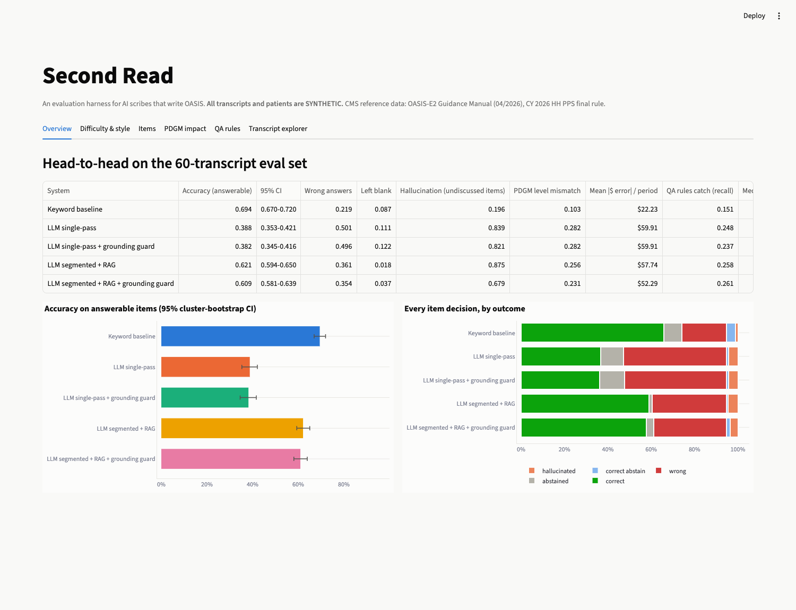
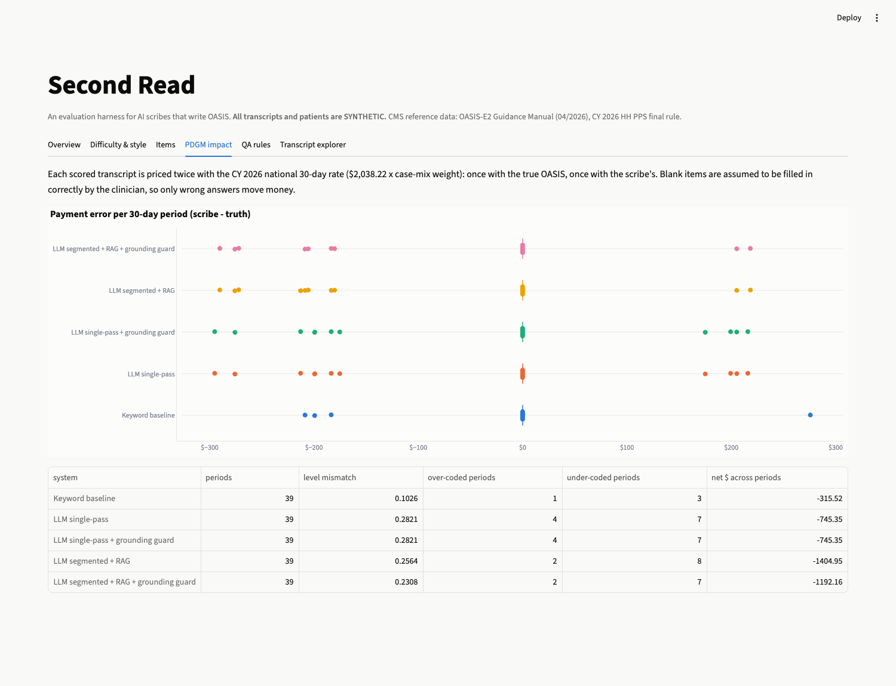
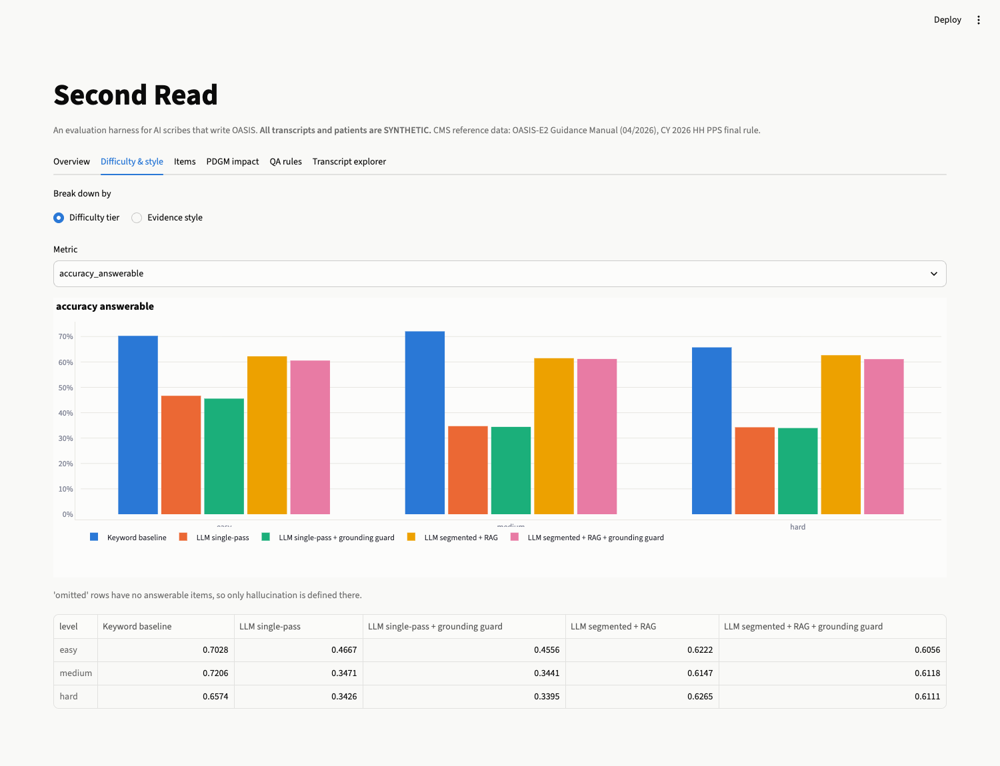
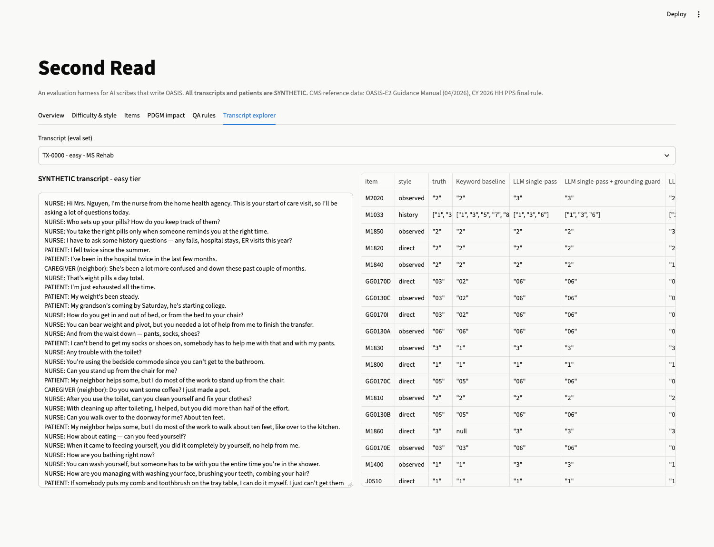

# Second Read

**An evaluation harness for AI scribes that write OASIS: how often they get it right, where they go wrong, and what each error costs under PDGM.**

> Home health agencies are adopting ambient AI scribes that listen to a nurse's start-of-care visit and fill in the
> OASIS assessment. OASIS answers drive both payment (PDGM) and public quality scores (Care Compare, HHVBP), so a wrong
> answer is a billing and compliance problem, not just a typo. This repo is the "second read": a reproducible way to
> measure a scribe item by item, catch its errors with QA rules, and put a dollar figure on what it gets wrong.

**All patients and transcripts in this repo are SYNTHETIC.** The CMS reference data (OASIS-E2 manual, CY 2026 PDGM
tables) is real and public.

---

## Results at a glance

Each LLM system ran on the **60-transcript eval set** (20 easy, 20 medium, 20 hard). That's 1,080 item decisions per
system, 1,024 of which had evidence in the transcript. Model: `qwen2.5:7b` running locally via Ollama on an Apple M2 (16 GB).
95% CIs come from a cluster bootstrap over transcripts.

| System | Accuracy (answerable items) | Wrong answers | Hallucination on undiscussed items | Wrong PDGM functional level | Mean \|payment error\| per 30-day period |
|---|---|---|---|---|---|
| LLM single-pass (all 18 items in one prompt) | 38.8% (35.3–42.1) | 50.1% | 83.9% | 28.2% | $59.90 |
| LLM single-pass + grounding guard | 38.2% (34.5–41.6) | 49.6% | 82.1% | 28.2% | $59.90 |
| **LLM segmented + RAG** (one call per item, CMS guidance retrieved) | **62.1% (59.4–65.0)** | 36.1% | 87.5% | 25.6% | $57.70 |
| **LLM segmented + RAG + grounding guard** | **60.9% (58.1–63.9)** | **35.4%** | **67.9%** | **23.1%** | **$52.30** |
| Keyword baseline *(optimistic ceiling, see caveat)* | 69.4% (67.0–72.0) | 21.9% | 19.6% | 10.3% | $22.20 |

**What the results say**

1. **Architecture matters more than prompting.** Splitting the job into one small, grounded call per OASIS item
   took accuracy from **38.8% to 62.1%** with the same 7B model. The gain is largest exactly where scribes are supposed
   to add value:

   | Evidence style | Single-pass | Segmented + RAG |
   |---|---|---|
   | Patient describes "before the hospital" vs "now" (code **now**) | 20.8% | **70.8%** |
   | Caregiver contradicts the patient (trust the correction) | 21.2% | **46.2%** |
   | Nurse narrates what she observed | 36.3% | **64.9%** |
   | Hard-tier transcripts overall | 34.3% | **62.7%** |

   Single-pass accuracy falls from 46.7% on easy transcripts to 34.3% on hard ones. Segmented accuracy stays flat (62.2% → 62.7%).
2. **Hallucination is the dangerous failure.** When an item was never discussed, the right answer is to leave it
   blank for the clinician. Every LLM configuration filled in a value **68–88%** of the time. Requiring a verbatim quote
   and rejecting answers whose quote isn't in the transcript (the *grounding guard*) brought that down from 87.5% to
   67.9% for a 1.2-point accuracy cost. The guard helps, but it isn't a substitute for a human QA pass.
   *Small sample: 56 undiscussed-item decisions.*
3. **Errors have a dollar sign.** For the 39 eval transcripts where every PDGM functional item was discussed, I priced each
   30-day period twice with the CY 2026 national rate ($2,038.22 × case-mix weight): once with the true OASIS and
   once with the scribe's. The best LLM system put **9 of 39 periods (23%) in the wrong functional impairment
   level**, **7 of them under-coded**. That averages a $52 absolute error per period, with a net under-payment of
   $30.60 per period, and up to $290 on a single period. For scale: the same net bias across 10,000 periods a year would be about
   $306K. *(That's arithmetic on a 39-period sample, not a measured result.)*
4. **QA rules catch about a quarter of the errors.** Ten cross-item consistency rules (e.g., *bedfast in M1850 must
   match M1860*, *GG sit-to-stand must agree with M1850*) fired 61 times on the best system's output and caught
   **26%** of its wrong answers on rule-covered items. Because the synthetic ground truth never violates a rule, every
   flag points at a real error by construction (precision is trivially 100%). Recall is the meaningful number.
5. **Item-level picture (segmented + RAG + guard):** strongest on dyspnea M1400 (89%, κw 0.96), lower-body dressing
   M1820 (86%) and pain-sleep J0510 (85%, κw 0.96). Weakest on GG mobility transfers (GG0170E 38%, GG0170D 43%) and the M1033
   risk checklist (exact set match 7%, mean Jaccard 0.57, agreement on the PDGM "4+ risks" flag 75%). Median
   quadratic-weighted κ across ordinal items: **0.76**, vs 0.55 for single-pass.

**About the keyword baseline.** It scores highest, and it shouldn't be read as "keywords beat LLMs." I wrote its cue
lists alongside the synthetic phrase banks, so it effectively knows the test vocabulary. Real speech wouldn't use
those phrases. It still collapses on caregiver corrections (30%) because it can't reason about who is right. Treat it as an
upper bound for template matching on this dataset. The fair comparison is between the LLM configurations.

### Dashboard

| Overview | PDGM impact |
|---|---|
|  |  |
| **Difficulty & evidence style** | **Transcript explorer** (truth vs every system, item by item) |
|  |  |

---

## Why this project exists

The home health AI companies I'm targeting sell this exact capability:

| Company | What they sell | What this harness measures for them |
|---|---|---|
| Andy, Lime Health, Enzo, Scribble, Roger | Ambient OASIS scribe + coding/QA | Item accuracy, hallucination, PDGM revenue impact |
| Nestmed | Enterprise ambient notes into the EMR | Same, plus QA-rule triage before EMR sync |
| Eleos Health | Documentation AI with pre-submission compliance review | Consistency rules, grounding, "define what good AI output looks like" |
| Turing | LLM evaluation and training data | Synthetic benchmark design with known ground truth |

## How it works

```
CMS (real)                        Synthetic (labeled)                 Systems under test            Scoring
──────────                        ───────────────────                 ──────────────────            ───────
OASIS-E2 manual (Apr 2026) ─┐     300 patients, answers calibrated    keyword baseline              accuracy / wrong / blank
CY2026 PDGM case-mix (432)  ├──►  to CMS Table 8 distributions   ──►  LLM single-pass          ──►  hallucination on undiscussed items
Functional points, Table 8  │     300 visit transcripts, 3 tiers      LLM segmented + RAG           weighted kappa, within-one
Thresholds, Table 9         │     6 evidence styles                   + grounding guard             PDGM level + $ per period
$2,038.22 rate, Table 14  ──┘                                                                       10 QA rules: fires / recall
```

### 1. Reference data (real, `data/reference/`)
- **PDGM:** all 432 CY 2026 case-mix weights and LUPA thresholds (CMS CSV). The functional points table (Table 8) and
  impairment thresholds by clinical group (Table 9) are published only as **images** in the CY 2026 HH PPS final rule
  (90 FR 55342), so I transcribed them from the rendered pages and unit-tested them against worked examples.
  National standardized 30-day rate: **$2,038.22** (Table 14).
- **OASIS-E2 Guidance Manual** (effective 04/01/2026): 62 retrievable passages covering item intent, coding instructions and tips
  for the 18 items.

### 2. Synthetic data (`data/synthetic/`, labeled `"synthetic": true`)
- **Patients (300):** the 7 PDGM functional items are driven by correlated latent traits (mobility, self-care, cognition,
  respiratory, pain) through a Gaussian copula. Their marginal distributions are **calibrated to the "percent of periods"
  column of CMS Table 8**, and the M1033 "4+ risks" rate matches CMS's 43.6%. Hard clinical constraints keep every
  record internally consistent (e.g., bedfast in M1850 ⇔ bedfast in M1860).
  Sanity check I didn't tune for: the resulting low/medium/high functional levels split ≈ ⅓ / ⅓ / ⅓, which is what
  CMS designs the thresholds to produce.
- **Transcripts (300):** each item is expressed in one of six ways: *direct* statement, nurse *observation*,
  *caregiver* report, *correction* (patient overstates, caregiver or nurse corrects), *temporal* contrast
  ("before the hospital… now…"), or *omitted* (never discussed, so the expected answer is blank). Tiers mix these
  and add small talk, statements about other people and speech-recognition disfluencies. Phrases are everyday
  language, not CMS wording.

### 3. Systems under test (`src/scribe_eval/extract/`)
- **Single-pass:** the whole transcript plus all 18 items and their response options in one prompt, with JSON-schema
  output and a verbatim evidence quote per item.
- **Segmented + RAG:** for each item, TF-IDF picks the most relevant transcript lines (plus context), retrieves the
  most similar passages of *that item's* CMS guidance, and asks the model about one item only. That's 18 small calls per visit.
- **Grounding guard** (post-processing, any LLM system): if an answer's quoted evidence can't be found in the
  transcript, the answer is blanked for the clinician. Multi-sentence quotes are checked sentence by sentence, and one
  invented sentence fails the quote.

### 4. Scoring (`src/scribe_eval/evaluate.py`, `metrics.py`, `qa_rules.py`, `pdgm.py`)
Each item decision is one of: *correct*, *wrong*, *left blank* (answerable item), *correct blank* or
*hallucinated* (undiscussed item). PDGM pricing assumes the clinician fills in anything left blank, so only wrong answers move money.

---

## Run it

```bash
make setup        # venv + pinned deps (Python 3.11)
make test         # 15 tests: CMS tables, generator calibration, QA rules, guard, API
make data         # regenerate the synthetic dataset (deterministic seed)
make baseline     # keyword baseline on all 300 transcripts (seconds)
ollama pull qwen2.5:7b && make llm   # both LLM systems on the 60-transcript eval set (resumable)
make evaluate     # writes data/results/*.csv + summary.json
make dashboard    # Streamlit: overview, difficulty/style, items, PDGM impact, QA rules, transcript explorer
make api          # FastAPI on :8000. POST /extract, /qa-check, /pdgm/functional; GET /metrics
```

`make reference` re-downloads the CMS files and rebuilds `data/reference/` (needs poppler for `pdftotext`).
**Docker:** a `Dockerfile` and `docker-compose.yml` (API + dashboard + Ollama) are included but **untested**, because Docker
wasn't available on the machine this was built on.

**Runtime and cost.** All inference is local and free. On an M2 with 16 GB, the median was about 90 s per transcript for either LLM
system; the full eval took about 4 hours. Ollama parallel slots didn't add throughput on this GPU.

```
src/scribe_eval/
  items.py          18 OASIS-E2 items (M1800–M1860, M1033, M1400, J0510, M2020, 7 GG items)
  pdgm.py           CY2026 functional points → level → HIPPS weight → $ per period
  synth/            patients.py (calibrated generator), transcripts.py (tiers/styles), phrases.py
  extract/          rules.py, llm.py (single-pass), segmented.py (per-item RAG), base.py (sanitize + guard)
  retrieval.py      TF-IDF over OASIS-E2 manual passages
  qa_rules.py       10 cross-item consistency rules
  metrics.py        outcome classes, weighted kappa, cluster bootstrap
  evaluate.py       all result tables
api/main.py         FastAPI service
dashboard/app.py    Streamlit dashboard
data/reference/     CMS-derived tables (real)   data/synthetic/  (synthetic)   data/results/ (predictions + metrics)
```

## Limitations and honest notes
- **Synthetic speech is cleaner than real visits.** Templates can't reproduce real ASR errors, crosstalk, accents or
  how nurses actually ask questions. Absolute accuracy here should not be read as a forecast for real recordings. The
  relative comparisons (single-pass vs segmented, guard vs no guard, which styles are hard) are the point.
- **One small local model.** `qwen2.5:7b` was chosen so the whole benchmark is free and reproducible offline. Commercial
  scribes use larger models plus human review. The harness is model-agnostic: point `--model` at any Ollama model.
- **Sample sizes:** 60 eval transcripts per LLM system; 39 PDGM-scorable periods; 56 undiscussed-item decisions.
  CIs are reported where they matter.
- **A bug found and fixed during evaluation:** the first version of the grounding guard required one contiguous quote
  and wrongly blanked correct M1033 answers whose evidence stitched several sentences together. It now checks each
  sentence (with a test for both the accept and the reject case). The table above uses the fixed guard; model
  predictions were not re-run.
- **Keyword baseline** is optimistic by construction (see above).
- **PDGM pricing** uses the national rate without wage-index, outlier or LUPA adjustments, and holds clinical group,
  admission source, timing and comorbidity fixed. Only the functional level is affected by the scribe.
- **QA rule precision** is 100% by construction on synthetic ground truth. Recall is the meaningful measure.

## License and disclaimer
MIT. Research and portfolio project. Not a medical device, not for clinical documentation or billing, and not
affiliated with CMS or any company named above. Synthetic data only; no PHI.
